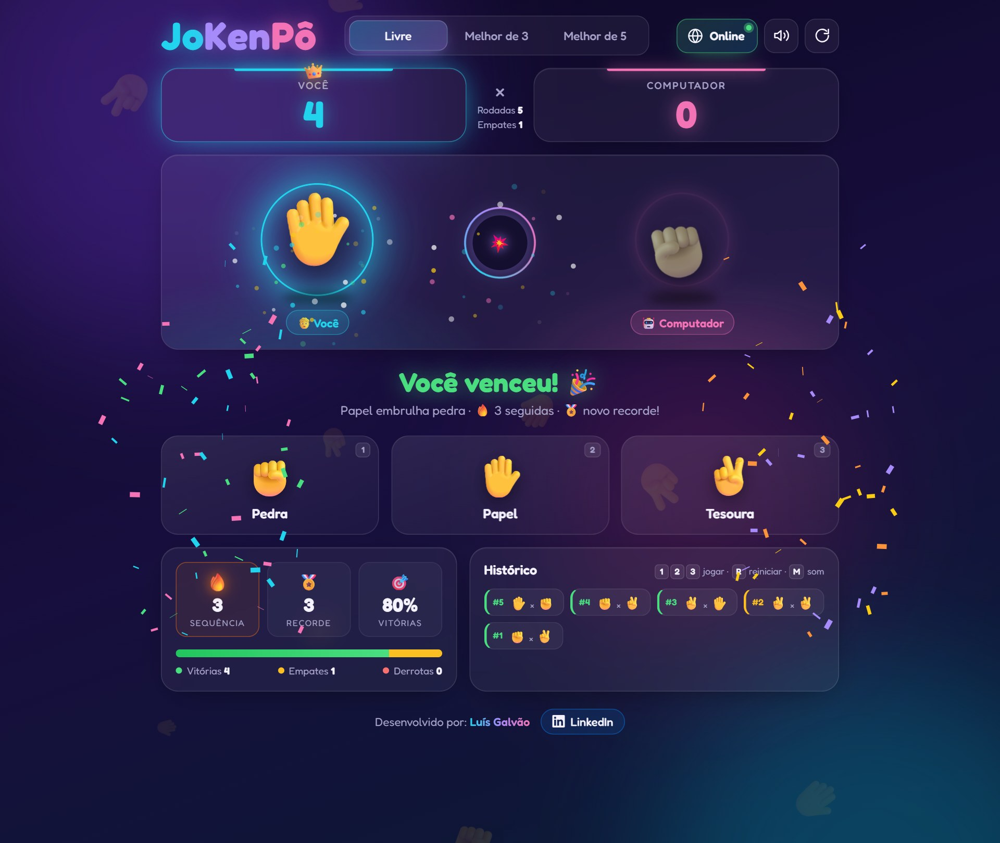
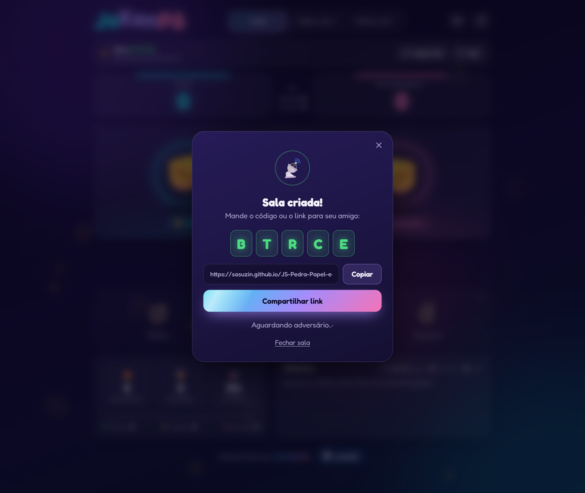
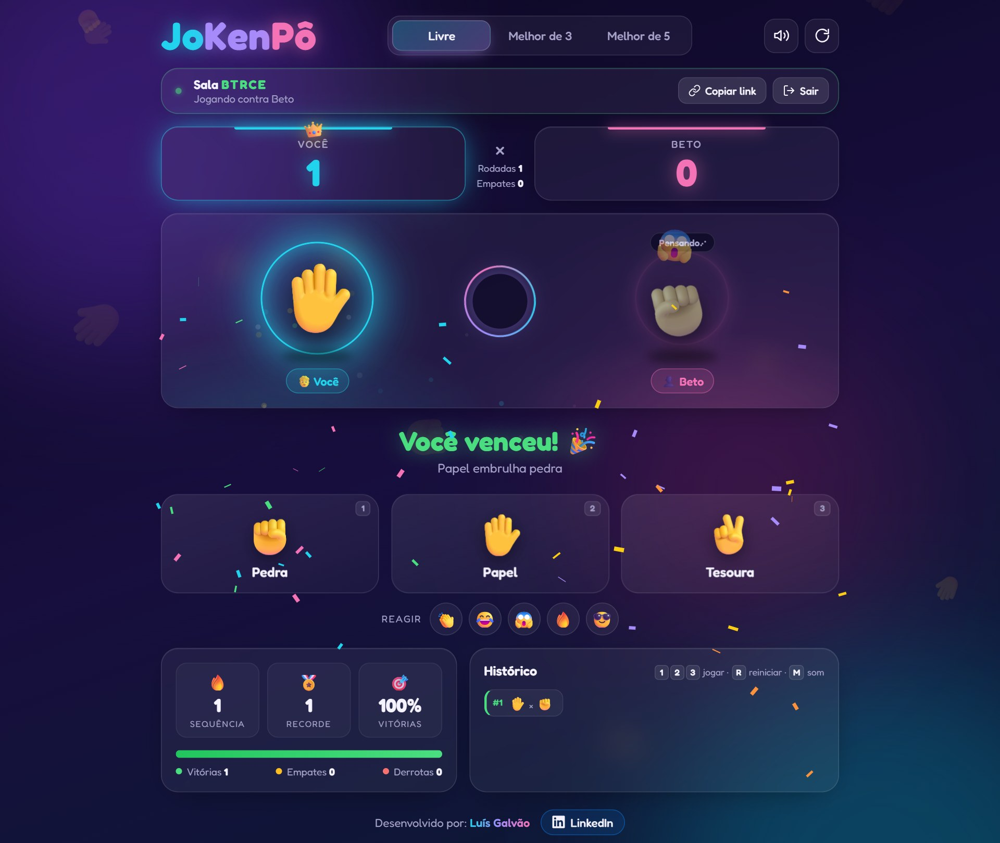
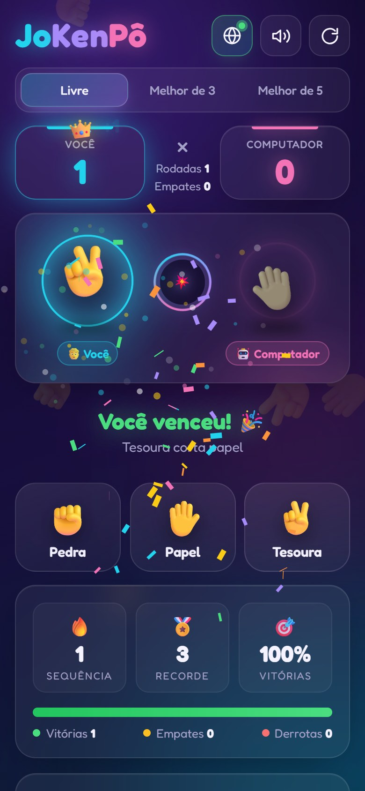

<div align="center">

# ✊ ✋ ✌️ JoKenPô

### Pedra, papel e tesoura com visual neon, muita animação e partidas online contra um amigo

[](https://sasuzin.github.io/JS-Pedra-Papel-e-Tesoura/)
[](https://sasuzin.github.io/JS-Pedra-Papel-e-Tesoura/)


<br>



</div>

---

## ✨ Destaques

| | |
|---|---|
| 🎬 **Jo… Ken… Pô!** | As mãos sobem e descem no ritmo da contagem e se revelam com onda de choque e faíscas |
| 🌐 **Online com um amigo** | Crie uma sala, mande o link e joguem um contra o outro em tempo real |
| 🏆 **Melhor de 3 e de 5** | Bolinhas de progresso, coroa para quem lidera e tela de fim de partida com revanche |
| 🎉 **Efeitos** | Confete na vitória, tela tremendo na derrota, clarões coloridos e sons gerados na hora |
| 📊 **Estatísticas** | Sequência de vitórias, recorde salvo no navegador, % de vitórias e histórico das rodadas |
| 📱 **Responsivo** | Funciona no computador e no celular, com atalhos de teclado e suporte a leitores de tela |

## 🌐 Jogando online

1. Abra o jogo e clique em **Online**, no canto superior direito.
2. Digite seu nome e clique em **Criar sala**. Aparece um código de 5 letras e um link.
3. Mande o link para um amigo (ou passe o código). Ele abre, digita o nome e clica em **Entrar**.
4. Pronto! Cada um escolhe sua jogada e as mãos se revelam ao mesmo tempo. Ainda dá para mandar reações 👏 😂 😱 🔥 😎

<table>
  <tr>
    <td align="center"><br><sub><b>Sala criada:</b> é só mandar o link</sub></td>
    <td align="center"><br><sub><b>Partida valendo</b> contra um amigo</sub></td>
  </tr>
</table>

> [!NOTE]
> 🔒 **Sem trapaça:** sua jogada sai do navegador *lacrada* (um hash SHA-256 com um segredo aleatório). O adversário só descobre o que você escolheu depois que os dois já jogaram, e o jogo confere se a jogada revelada bate com o lacre.

<details>
<summary><b>⚙️ Como o modo online funciona por dentro</b></summary>
<br>

- Os dois navegadores conversam **direto entre si** por **WebRTC**, usando a biblioteca [PeerJS](https://peerjs.com/).
- O servidor público do PeerJS só faz a apresentação inicial entre os jogadores. Por isso o jogo não precisa de backend e roda 100% no **GitHub Pages**.
- Quem cria a sala comanda o modo de jogo e o placar; o convidado acompanha.
- Se alguém fecha a aba ou a conexão cai, o outro é avisado na hora. Quem criou a sala continua esperando um novo adversário.
- Em redes muito restritas (algumas redes de empresa ou de faculdade), a conexão direta pode ser bloqueada.

</details>

## 🎮 Regras e controles

| Jogada | Vence | Por quê |
|:---:|:---:|---|
| ✊ Pedra | ✌️ Tesoura | a pedra amassa a tesoura |
| ✋ Papel | ✊ Pedra | o papel embrulha a pedra |
| ✌️ Tesoura | ✋ Papel | a tesoura corta o papel |

| Tecla | Ação |
|:---:|---|
| <kbd>1</kbd> <kbd>2</kbd> <kbd>3</kbd> | Jogar pedra, papel ou tesoura |
| <kbd>R</kbd> | Zerar o placar |
| <kbd>M</kbd> | Ligar ou desligar o som |
| <kbd>Esc</kbd> | Fechar janelas |

## 📱 No celular

<div align="center">

</div>

## 🛠️ Tecnologias

- **HTML5, CSS3 e JavaScript puro**: sem framework e sem etapa de build
- **CSS moderno**: animações com `@keyframes`, efeito de vidro com `backdrop-filter`, `color-mix()`, Grid e Flexbox
- **Canvas 2D**: confetes e faíscas
- **Web Audio API**: todos os sons são sintetizados na hora, sem nenhum arquivo de áudio
- **WebRTC + PeerJS**: modo online sem servidor próprio
- **Web Crypto (SHA-256)**: o lacre das jogadas online
- **localStorage**: recorde, nome e preferência de som

## 🚀 Rodando no seu computador

```bash
git clone https://github.com/Sasuzin/JS-Pedra-Papel-e-Tesoura.git
cd JS-Pedra-Papel-e-Tesoura
python -m http.server 8000
```

Depois abra <http://localhost:8000>. Para jogar só contra o computador, também dá para abrir o `index.html` direto no navegador.

## 📁 Estrutura

```text
📦 JS-Pedra-Papel-e-Tesoura
 ┣ 📜 index.html   → estrutura da página
 ┣ 🎨 index.css    → visual, animações e responsividade
 ┣ 🎮 jokenpo.js   → regras, animações, placar, sons e efeitos
 ┣ 🌐 online.js    → salas online (PeerJS + lacre das jogadas)
 ┗ 🖼️ docs/        → imagens deste README
```

## 📜 Sobre o projeto

Começou como trabalho do segundo semestre de TSI e depois ganhou um visual novo, animações e o modo online.

---

<div align="center">

Desenvolvido por **Luís Galvão**

[](https://www.linkedin.com/in/luis-galv%C3%A3o/)
[](https://github.com/Sasuzin)

⭐ Curtiu? Deixa uma estrela no repositório!

</div>
